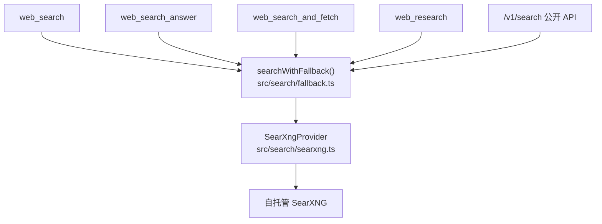
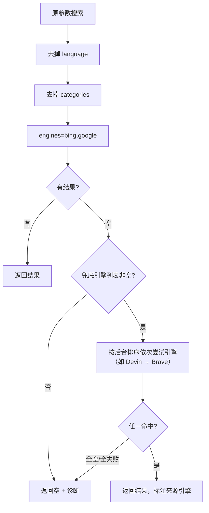

# 商业兜底搜索引擎 设计方案

> 状态：已实施（v2，2026-10-18 施工完成，见开发计划施工日志；SKILL 同步改写待用户批准后执行）；「兜底触发时机」待后续讨论确认
> 日期：2026-10-18
> 背景：借鉴 dsh-devin-search（github.com/mimimaster/dsh-devin-search），为 linkseek 增加免费的商业搜索兜底能力

## 一、背景与目标

linkseek 的搜索能力全量依赖自托管 SearXNG 元搜索——免费、可自建，但开源引擎的召回质量与商业搜索（如 Exa、智谱内置搜索）有明显差距。当 SearXNG 降级链全部走空时，调用方（AI）只能拿到一份「已尽力」的空结果报告，没有更强的兜底手段。

dsh-devin-search 项目证明了一条可行路径：通过 Devin OAuth 登录换取 token，调用 Windsurf/Codeium 的 Exa 搜索接口（`GetWebSearchResults`），免费获得商业级搜索质量。其结果结构（`{title, url, snippet}`）与 linkseek 的 `SearchResult` 几乎同构，移植成本低。

**目标**：在 linkseek 中增加可插拔的商业兜底搜索层——SearXNG 降级链全空时自动触发，opt-in 默认关闭，不动任何现有对外行为。

**非目标**：

- 不替代 SearXNG 作为主搜索引擎（兜底定位，控制调用量与风险）
- 不做 code_search（已确认无需求）
- 不在 MCP 工具层新增任何命令或参数（对 AI 透明）

## 二、现状架构与注入点

搜索主链路只有一个汇聚点，5 个调用方全部经过同一函数：



关键事实：

- **唯一注入点**：`searchWithFallback`（src/search/fallback.ts:20）。改造只需动这一个函数 + 新增模块，工具层零改动。
- **结果结构同构**：linkseek `SearchResult {title, url, snippet}`（provider.ts:21）与 Devin/Exa 返回结构一一对应。
- **配置存储现成**：`SystemSetting` 表 + `src/lib/settings.ts`，与 LlmProvider.apiKey 同级别的凭证存储先例。
- **管理后台现成**：Vue SPA + Express admin router，「任务设置」页（TaskSettings.vue + settings-routes.ts）是可抄的完整范式。

## 三、借鉴来源分析

从 dsh-devin-search 提取四个模块，其余不借鉴：

| 模块 | 来源 | 借鉴内容 | 移植量 |
|---|---|---|---|
| 粘贴码 OAuth | oauth.ts `oauthCode()`（29-38 行） | 无需回调端口，适合服务器/容器部署 | 约 40 行 |
| 搜索客户端 | web.ts `webProvider()`（全文 78 行） | 双 host 故障转移（server.codeium.com → server.self-serve.windsurf.com）、防御性字段解析（url/sourceUrl/webUrl/link 等多键兜底）、URL 白名单校验、token 脱敏 | 约 80 行 |
| token 工具 | safety.ts | `toDevinSessionToken()`（裸 JWT 包装为 `devin-session-token$<jwt>`）、`expiry()`（从 JWT exp 解析过期时间，兜底 365 天）、`redact()`（日志脱敏） | 约 30 行 |
| 熔断策略 | web.ts:71-74 | 仅当全部 host 返回 401/403 才判定 token 失效，单 host 故障不误杀 | 含在客户端中 |

不借鉴的部分：DSH 插件注册机制（cordis 依赖注入）、code_search 工具、loopback 回调模式（需要公网可达的回调端口，服务器部署不适用）。

## 四、改造设计

### 4.1 新增模块

全部为新文件，不改动现有模块：

```text
src/search/commercial/
├── types.ts          # CommercialEngine 接口 + 引擎注册表条目类型
├── devin.ts          # Devin/Exa 引擎（OAuth + 搜索客户端 + token 工具）
├── brave.ts          # Brave Search API 引擎（正规免费额度 2000 次/月）
└── manager.ts        # 引擎管理器：读取后台排序列表、按序尝试、状态记录
```

接口设计（与现有 `SearchProvider` 对齐，输出直接复用 `SearchResult` 类型）：

```typescript
// types.ts
export interface CommercialEngine {
  readonly id: string;                    // 'devin' | 'brave'
  available(): Promise<boolean>;          // 配置齐全且凭证未失效
  search(query: string, maxResults: number): Promise<SearchResult[]>;
}
```

### 4.2 fallback.ts 注入点

在降级链全部走完、即将返回空结果之前，按后台配置的引擎顺序尝试商业兜底：



行为约定：

1. **只在空结果时触发**，不替代 SearXNG 主链路；把商业引擎消耗压到最低。（触发时机是否放宽——如「结果少于 N 条也兜底」——待后续讨论，当前按全空触发设计。）
2. **失败静默**：单个引擎异常（token 失效、配额耗尽、网络不通）只记入诊断并继续尝试下一个引擎；全部失败不改变对外行为——未配置兜底的部署完全无感。
3. **诊断透明**：兜底命中时在 `diagnostics.attempts` 追加一条记录（label 如 `商业兜底:devin`），调用方能识别结果来源。
4. **凭证失效熔断**：某引擎连续鉴权失败（如 Devin 双 host 全 401/403）时本地标记失效，后续请求直接跳过该引擎；管理后台显示失效状态提示重新配置。

### 4.3 Devin 登录与凭证管理

linkseek 是独立服务器，登录流程走管理后台而非 MCP 命令：

**登录流程（粘贴码模式）**：

1. 管理员在后台「搜索兜底」设置页点击「登录 Devin」
2. 后端生成 PKCE verifier/challenge，构造授权 URL（`https://app.devin.ai/auth/cli/continue?...`），暂存 verifier，返回 URL 给前端展示
3. 管理员在浏览器打开 URL、登录 Devin 账号、获得一次性授权码，粘贴回设置页输入框
4. 后端用授权码 + verifier 调 `https://api.devin.ai/auth/cli/token` 换取 session token
5. token 包装为 `devin-session-token$<jwt>` 形式后存入 SystemSetting（key: `devinSearchToken`），verifier 丢弃
6. 设置页展示登录状态：未登录 / 已登录（过期时间从 JWT exp 解析）/ 已失效，不暴露 token 本身

**存储**：SystemSetting 表（现有设施，无需数据库迁移）。token 明文存储——与 LlmProvider.apiKey 同级别的服务端第三方凭证，风险一致。

### 4.4 web_search 新增 `provider` 参数（AI 直调入口）

AI 侧唯一的感知点：`web_search` 工具增加一个可选枚举参数，让 AI 可以主动选择搜索路径，而不是只能被动等待兜底。

| 取值 | 行为 |
|---|---|
| `auto`（默认） | 现有路径不变：SearXNG 降级链 → 全空后按引擎列表兜底 |
| `cloud` | 跳过 SearXNG 降级链，直接按后台引擎列表顺序打商业引擎 |

设计说明：

- **做成参数而非新工具**：新工具会让 AI 在工具选择上多一类误用（「什么时候用 web_search 什么时候用 web_search_pro」），且膨胀 SKILL 篇幅；参数语义更干净。
- **典型场景**：
  - AI 预判查询对 SearXNG 不友好（很新的英文技术内容、对时效性/质量要求极高）时直出重拳，省掉降级链的无效尝试。
  - SearXNG 正常返回（未触发兜底）但结果质量不理想（多次搜索仍答非所问、来源不权威）时，主动切 `cloud` 换商业引擎重搜。即 `cloud` 不仅是「搜不到时的兜底」，也是「搜到了但不够好时的提质手段」。
- **成本可控**：`cloud` 消耗商业引擎额度，SKILL 参数手册写明「默认 auto，仅在明确需要时用 cloud」。
- **宿主无关的兜底**：`provider='cloud'` 落地后，linkseek-usage 技能中「换内置 WebSearch」的指引必须同步改写——该说法依赖 ZCode + GLM 登录态这一私有宿主环境，在 Claude Code 等其他 MCP 客户端中不存在此设施。改为引导 AI 使用 `provider='cloud'` 后，兜底能力收回服务端，任何宿主通用。涉及技能的三处：第四节失败应对 SOP（改写一次仍空 → 改用 `provider='cloud'` 重试）、第六节整节（从「与内置 WebSearch 的关系」改为「商业引擎兜底的使用时机」）、第七节版本依赖（补一条 `provider` 参数的部署版本要求）。**SKILL 修改与参数实现需同批发布**，避免 AI 按新指引调用尚未部署的参数。
- 其余 4 个调用方（web_search_answer / web_search_and_fetch / web_research / /v1/search）沿用 `auto` 路径，第一期不暴露该参数。

改动面：`web-search.ts` 的 inputSchema 加一个 zod 枚举字段 + fallback.ts 顶部按参数分流。

### 4.5 兜底引擎列表化管理（后台可排序）

不按固定优先级写死 Devin → Brave，而是在 SystemSetting 存一份**引擎列表**，后台可增删、启停、上下移排序（本期不做拖拽，拍死于开发计划）：

| SystemSetting key | 说明 |
|---|---|
| `commercialEngines` | JSON 数组，按数组顺序定义兜底尝试顺序，例：`[{"id":"devin","enabled":true},{"id":"brave","enabled":true}]` |
| `devinSearchToken` | Devin session token（登录后自动写入） |
| `braveSearchApiKey` | Brave Search API Key（手动填写） |

行为约定：

- 列表为空或未设置 = 兜底整体关闭（默认状态）。
- 引擎条目 `enabled:false` 时保留配置但跳过，便于临时停用。
- 尝试顺序严格按数组顺序；某引擎凭证缺失/失效时自动跳过并记入诊断。
- 新增引擎类型（如 Tavily，免费 1000 次/月）= 代码里加一个实现类 + 后台列表里多一个可选条目，框架不变。

凭证明细仍按引擎各自存独立 key（便于 Devin 登录流程自动回写 token），列表 key 只管顺序与启停。

### 4.6 管理后台

新增「搜索兜底」设置页（参照 TaskSettings.vue 范式），分两个区域：

**引擎列表管理区**：

- 引擎条目列表：名称、启用开关、上下移按钮排序（本期不做拖拽）
- 每个引擎的凭证配置入口（Devin → 登录卡片；Brave → API Key 输入框）
- 各引擎状态徽标：未配置 / 正常 / 凭证失效

**Devin 登录卡片**（列表中 Devin 条目展开）：

- 状态展示：未登录 / 已登录（过期时间从 JWT exp 解析）/ 已失效，不暴露 token 本身
- 登录按钮 → 展示授权 URL → 授权码输入框 → 提交换 token
- 注销按钮

**Brave 条目展开**：API Key 输入框（密码式掩码显示）。

后端在 `settings-routes.ts` 增加端点：

| 方法 | 路径 | 说明 |
|---|---|---|
| GET | `/api/settings/search-fallback` | 读取引擎列表 + 各引擎状态（token 只回状态不回明文） |
| PUT | `/api/settings/search-fallback` | 更新引擎列表（顺序、启停）与 Brave Key |
| POST | `/api/settings/search-fallback/devin-login` | 发起登录：生成并返回授权 URL |
| POST | `/api/settings/search-fallback/devin-exchange` | 用粘贴的授权码换 token 并存储 |
| DELETE | `/api/settings/search-fallback/devin-token` | 注销：清除存储的 token |

## 五、改动清单

| 文件 | 动作 | 说明 |
|---|---|---|
| `src/search/commercial/types.ts` | 新增 | CommercialEngine 接口，约 15 行 |
| `src/search/commercial/devin.ts` | 新增 | Devin/Exa 引擎 + OAuth + token 工具，约 150 行 |
| `src/search/commercial/brave.ts` | 新增 | Brave 引擎，约 40 行 |
| `src/search/commercial/manager.ts` | 新增 | 引擎管理器（读列表、按序尝试、熔断状态），约 60 行 |
| `src/search/fallback.ts` | 改约 40 行 | provider 参数分流 + 空结果后按引擎列表兜底 |
| `src/tools/web-search.ts` | 改约 10 行 | inputSchema 加 `provider` 枚举 + 透传 |
| `src/admin/settings-routes.ts` | 改约 90 行 | 引擎列表读写 + 各引擎凭证配置 + Devin 登录/换 token/注销 |
| `web/src/views/SearchFallback.vue` | 新增 | 设置页（列表管理 + 各引擎凭证区），约 200 行 |
| `web/src/router.ts` | 改 1 行 | 挂页面路由 |
| `.env.example` | 补说明 | 无需新环境变量（全走 SystemSetting），仅文档提及 |

除 web_search 的 `provider` 参数外，其余 4 个调用方（web_search_answer / web_search_and_fetch / web_research / /v1/search）、MCP schema、公开 REST API：**零改动**。

## 六、风险与对策

| 风险 | 说明 | 对策 |
|---|---|---|
| ToS / 封号 | Devin 引擎本质是冒充 Windsurf IDE 客户端调用内部 API | 与 dsh-devin-search 同一姿态：opt-in、默认关闭、每个部署者用自己的 Devin 账号。文档写明风险；公开实例默认不开 |
| 免费额度未知 | Devin/Exa 免费额度无公开数字 | 兜底定位本身限制调用频率（只在全空时触发）；双 host 全 401 时本地熔断，避免反复打无效请求 |
| 上游接口变动 | Windsurf 内部 API 无稳定性承诺 | 引擎失败静默降级，主链路不受影响；坏了只是一个可选增强失效 |
| token 泄露 | 服务端存储第三方凭证 | 与 LlmProvider.apiKey 同级存储；设置页不回显明文；日志输出经 redact() 脱敏 |

## 七、施工顺序

1. **第一阶段（核心价值）**：`commercial/types.ts` + `commercial/devin.ts` + `commercial/manager.ts` + fallback.ts 注入点 + admin 引擎列表与凭证端点。先让 Devin 兜底跑起来。
2. **第二阶段**：管理后台设置页（引擎列表管理 + Devin 登录卡片交互）。
3. **第三阶段**：web_search 的 `provider` 参数 + SKILL（linkseek-usage）同步改写（去内置 WebSearch 依赖，改指 `provider='cloud'`）+ Brave 引擎 + 文档收尾。**provider 参数与 SKILL 修改必须同批发布**（SKILL 遵守「未经同意不改文件」纪律，届时需先取得用户同意）。

## 八、待讨论事项（暂未定稿）

- **兜底触发时机**：当前设计为「SearXNG 降级链全空才触发」。备选：「结果少于 N 条时也触发补充」——调用量会显著上涨，需权衡商业额度消耗。后续讨论后更新 4.2 节。
